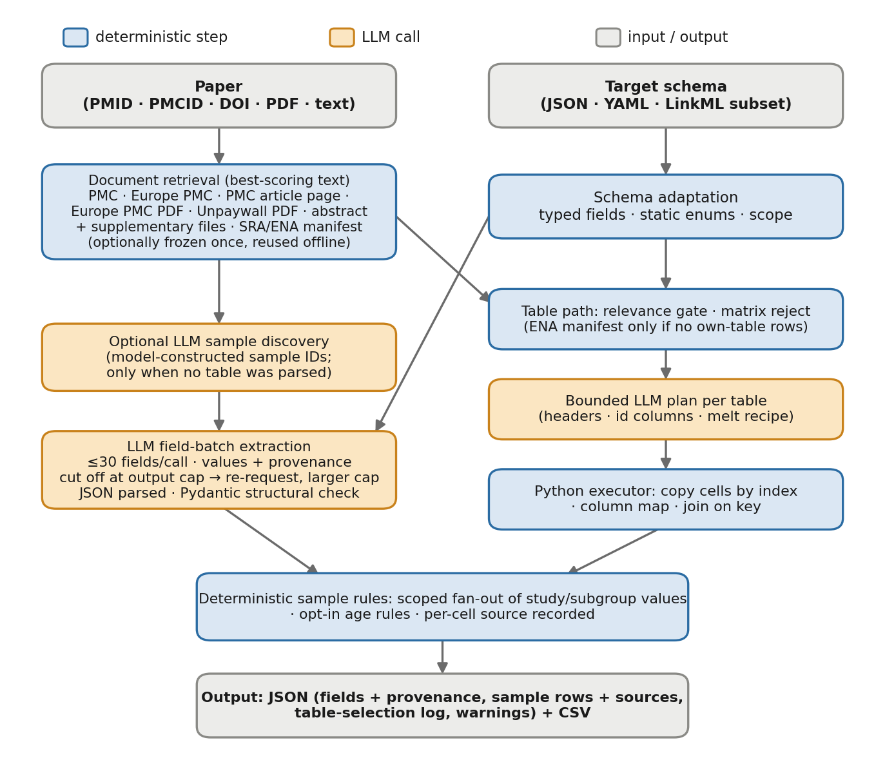
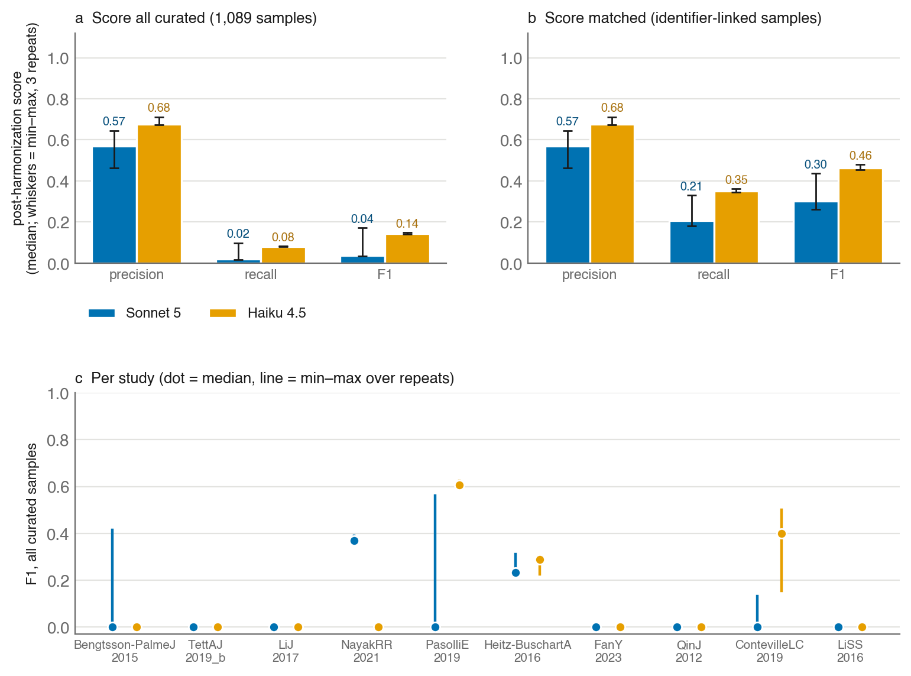
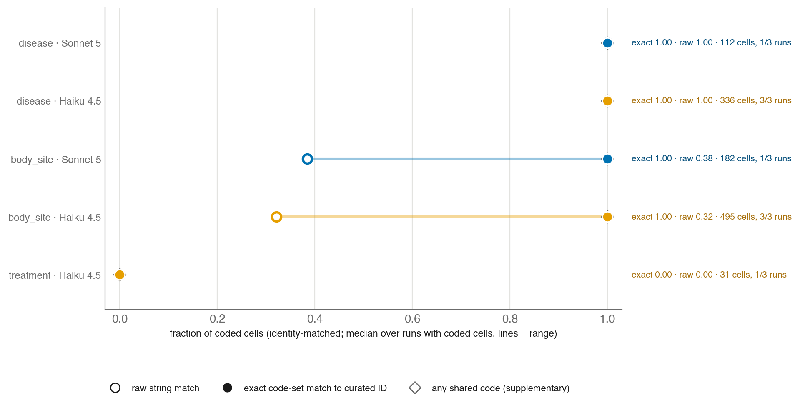

# MetaExtractor: schema-guided metadata extraction from scientific literature and sequencing archives, evaluated on curatedMetagenomicData

[AUTHORS AND AFFILIATIONS]

## Abstract

**Background.** Reusing public omics data depends on sample-level metadata that is usually reported in
free text, supplementary tables, and sequence-archive records rather than in a structured form.
We describe MetaExtractor, an open-source tool that combines large-language-model (LLM) extraction
with deterministic retrieval, table handling, and record assembly to populate a user-supplied schema,
and we evaluate it, together with ontology harmonization by MetaHarmonizer, against manually curated
metadata from curatedMetagenomicData (cMD).

**Methods.** Ten cMD studies (1,089 curated samples, 71-field schema) were retrieved once each, and
every study was then extracted three times with Claude Sonnet 5 and Claude Haiku 4.5 from the frozen
retrieval and one tagged code snapshot (60 extractions), with every fetch and extraction attempt
logged. Extracted sample records were aligned to curated rows by shared identifiers under a one-to-one
rule. Values were scored after harmonization: disease, body site, and treatment were mapped to
ontology codes with MetaHarmonizer and compared with the curators' ontology identifiers (or, where a
curated row has none, with the curated value mapped the same way); other fields were compared as extracted. We report precision, recall, and F1 over all curated samples and over
identifier-matched samples.

**Results.** Fifty-nine of 60 extractions produced output; the failure was a Haiku 4.5 response that
did not pass result-model validation in either attempt. Three Sonnet 5 responses stopped at the
16,384-token output cap and completed when re-requested with a larger cap. Extracted records were
matched to curated rows in five studies: 284 of 1,089 rows in every Sonnet 5 run and 214–284 in the
Haiku 4.5 runs. Over all curated samples, F1 was 0.203 [range 0.180–0.216] for Sonnet 5 and 0.193
[0.148–0.193] for Haiku 4.5 (paired difference +0.021; 95% study-cluster bootstrap interval −0.013 to
0.088); over matched samples it was 0.514 and 0.475, with precision 0.739 and 0.683. Among harmonized
fields, matched-sample F1 was 0.86–0.94 for body site and 0.65–0.78 for disease, involving few
distinct terms, and 0.34 or lower for treatment. Freezing retrieval removed the run-to-run text
differences observed in an earlier run of the same day, in which one study's full text was retrieved in
one of six extractions.

**Conclusions.** On this microbiome case study, post-harmonization accuracy was limited mainly by
sample enumeration and identifier linkage — most curated samples were never linked to an extracted
record — and, among linked samples, by values that no configured harmonization corpus covered.
Retrieval must be frozen and logged for extraction benchmarks to be repeatable, and truncated model
responses must be detected rather than parsed. Broader claims require held-out studies, baselines, and
additional domains.

---

## 1. Introduction

Sample-level metadata — disease status, body site, age, treatment, sequencing platform — determines
whether public omics data can be reused, combined, and modelled. Such metadata is typically scattered
across a paper's methods, supplementary tables, and linked archive records, and it is curated manually
into controlled schemas at considerable cost [CITE: metadata curation burden in public omics repositories].
Resources such as curatedMetagenomicData (cMD) provide this curation for shotgun metagenomic studies
[CITE: Pasolli et al. 2017] and therefore also provide a reference against which automated extraction can
be measured.

LLMs have been applied to biomedical information extraction and to metadata curation specifically
[CITE: LLM-based biomedical information extraction; LLM metadata curation tools]. Two properties make
the per-sample setting harder than study-level extraction. First, the set of samples must itself be
enumerated and each extracted record must be linked to the right curated sample before any value can be
judged. Second, values stated for a cohort (a disease list, a mean age) must not be silently copied onto
individuals. Evaluations that score values positionally, or that count a reported-but-wrong value as a
hit, can report high accuracy without establishing either property.

A third issue is what counts as a correct value. A paper may call a sample "Stool" where the curated
table says "feces", or "Rheumatoid Arthritis" where it says "RA". Mapping such surface forms to a
controlled vocabulary is a separate harmonization step, and scoring verbatim extracted strings against
curated labels charges the extractor for differences that harmonization is designed to remove. We
therefore score the extraction-plus-harmonization pipeline: values are compared after ontology mapping
with MetaHarmonizer [CITE: MetaHarmonizer], and the scorer itself applies no further normalization.

MetaExtractor is a schema-guided extractor that confines model calls to reading prose and inferring table
structure, and handles retrieval, table execution, joining, and propagation deterministically, recording a
source for every sample cell. Here we (i) describe its design and its limits, including what its output
validation does and does not check; (ii) evaluate it on ten cMD studies with two models and three repeated
runs from a single logged snapshot and frozen retrieval, using identity-aligned scores after
harmonization; and (iii) report which fields and terms harmonization covered. We treat the evaluation as
a case study of one domain and one reference resource.

[CITE: related extraction and harmonization systems; LinkML (schema framework)]

---

## 2. Methods

### 2.1 Evaluation domain and study selection

curatedMetagenomicData (cMD) [CITE: Pasolli et al. 2017, curatedMetagenomicData] provides manually
curated, per-sample metadata tables for public shotgun metagenomic studies, expressed in a
controlled schema [CITE: cMD curation repository and schema release]. We used the curated
`inst/curated/<study>/<study>_sample.tsv` tables of `curatedMetagenomicDataCuration` at commit
`41271711` as the reference standard.

The `*_sample.tsv` tables were enumerated, shuffled with a fixed seed (42), and the first ten
studies with a single numeric PMID and at least one sample were retained
(`benchmarks/cmd_sonnet5/select_studies.py`; re-running it at the stated commit reproduces the
committed `manifest.json`). The set spans 15–363 gold samples per study (1,089 in total):
Bengtsson-PalmeJ_2015, TettAJ_2019_b, LiJ_2017, NayakRR_2021, PasolliE_2019,
Heitz-BuschartA_2016, FanY_2023, QinJ_2012, ContevilleLC_2019, LiSS_2016.

One selected table is a partial reference. cMD splits the curation of PMID 31607556 across
`TettAJ_2019_a`, `_b` and `_c` (68, 44 and 50 samples), and the sampler drew `_b`; because one
extraction covers the whole publication, scoring it against `_b` alone understates the reference.
Section 3.9 reports the corrected gold set of all three tables (162 samples, 1,207 in total).
Table 2 and Sections 3.1–3.8 report the run as frozen, against `_b`.

These ten studies were also used while the retrieval layer, table path, and harmonization
corpora were being developed. They are therefore not a held-out test set (Section 4.4).

### 2.2 MetaExtractor

MetaExtractor takes a paper (retrieved by identifier or supplied as text/PDF) and a target schema,
and returns a JSON result with study-level field values, optional per-sample records, provenance,
and a table-selection log; a flat CSV is also written (Figure 1).

**Figure 1. MetaExtractor architecture.** Blue boxes are deterministic steps, orange boxes are LLM
calls, and grey boxes are inputs and outputs. The model proposes study-level values with provenance,
optional sample identifiers, and a structural plan for each selected supplementary table. Retrieval,
table execution, column mapping, joining, fan-out, and age rules are deterministic, and each sample cell
records its source. A retrieval can be frozen once and reused without network access. A response cut
off at the output cap is re-requested with a larger cap. The Pydantic check validates the structure of
each model response, not its content.

**Schema input.** Schemas are read from JSON, YAML, or LinkML YAML (LinkML is detected by the
presence of `classes`/`slots`/`enums`). The LinkML adapter supports a subset of LinkML: the slots
and attributes of one class; `description`; numeric, boolean, and string ranges; enums with
static `permissible_values` (keys, descriptions, and `meaning` CURIEs); `multivalued` (mapped to a
list); `required`; `unit`/`ucum_unit`; and a `scope` annotation (`study` or `sample`). Other LinkML
semantics — `reachable_from` dynamic enums, `pattern`, numeric bounds, `is_a`/mixins,
`slot_usage`, class-valued ranges, and identifiers — are not interpreted. For cMD, 11 slots whose
range is a `reachable_from` enum were downgraded to free-text strings before loading, giving a
71-field schema (`make_clean_schema.py`); 54 slots were annotated `sample`, 10 `study`, and 7 left
unannotated. The scope annotation is used only by the deterministic fan-out rule below and is not
sent to the model.

**Retrieval.** For a PMID, the retrieval layer collects candidate texts from NCBI PMC full text,
Europe PMC full text (by PMCID, and by DOI), the PMC article web page and Europe PMC's rendered PDF
for PMC records outside the Open Access subset (whose XML is abstract-only), and an Open Access PDF
located through Unpaywall [CITE: Europe PMC; Unpaywall], with the PubMed abstract as a floor. It scores
each candidate for article-narrative quality and keeps the best body; costlier rungs are attempted only
while no body scores as clearly substantive. From the PMC article page only the article-body section
up to the reference list is kept, without tables and figures. Transient HTTP failures are retried.
Supplementary files are listed from the PMC Open Data S3 bucket and the Europe PMC supplementary
archive. Separately, the layer resolves the study's own sequencing project from accessions in
data-availability language (refusing ambiguous cases) and fetches its per-run manifest from the ENA
`read_run` endpoint [CITE: ENA]. Every attempted retrieval rung and its outcome is recorded.

A retrieval can be **frozen**: the text sent to the model, the parsed supplementary and manifest
tables, and the retrieval record are written to a directory with SHA-256 checksums
(`--fetch-cache`), and later extractions read them back — verifying the checksums — without network
access (`--require-fetch-cache` refuses to fetch).

**Model calls.** The model is reached through the Anthropic Messages API in three roles:
(i) *field extraction*, one call per batch of at most 30 schema fields; (ii) optional *sample
discovery*, which asks the model to construct a stable identifier for each sample described in
supplementary prose (identifiers encode attributes such as subject, body site, and timepoint and
are therefore model-generated); and (iii) a *table plan* per selected supplementary table, which
sees a truncated preview and returns header rows, identifier columns, and an optional melt recipe.
A fixed system prompt instructs the model to extract only what the supplied text supports, to
return `not_reported` for absent fields, not to create per-sample rows from aggregates, to return
enum values in the surface form used by the paper, and to attach an extraction type, confidence,
a ≤25-word evidence quote, and a section to each study-level value.

The stop reason of every response is recorded. A response that stopped at the output cap
(`max_tokens`) is not parsed; the same request is sent again with the cap doubled, up to 64,000 tokens
for field extraction and sample discovery and 16,384 tokens for table plans, and a response still
truncated at that ceiling is reported as an error (a failed table plan falls back to a row-0-header
parse). Token usage of every call, including truncated ones, is counted.

A complete response is parsed as JSON and validated with Pydantic against a fixed result model. That
validation is **structural**: it checks the result envelope (granularity, field records, provenance
slots). It does not check that field names belong to the target schema, that required fields are
present, that values have the declared type or belong to an enum, or that an evidence quote occurs in
the source. Field values are model-generated text; the prompt contract, not code, is what asks the
model to stay faithful to the source.

**Deterministic table path.** Parsed supplementary tables (xlsx/csv/tsv, PDF table regions) are
scored for schema relevance (header-name and enum-value overlap, an identifier-column signal, and
shape); tables scoring below 0.15, and feature × sample measurement matrices, are skipped. For a
selected table the plan is applied by a Python executor that copies cell values by index; category
labels in melted output come from the plan. Columns are mapped to schema fields by an exact →
normalized → alias → fuzzy cascade, and tables are left-joined on the highest-priority shared key
(`sample_id` > `subject_id` > `ncbi_accession` > `study_name`) when key overlap is at least 0.9.
The ENA run manifest enters this path only when the article's own tables yield no sample rows.
Whenever at least one structured table was parsed (including the manifest), sample records come
only from this path: sample discovery is not run, and per-sample rows the model may emit are
replaced by the table rows — even when the tables yield none. Sample discovery and model-emitted
sample rows therefore apply only to papers with no parsed table.

**Sample records and provenance.** Each sample cell carries a recorded source: a table or manifest
column, a per-sample value emitted by the model, or one of the deterministic rules below.

**Fan-out of study- and subgroup-level values.** Study-level values are propagated into sample
records only under the following rules (`metaextractor.sample_rules`). A value already present in a
sample is never overwritten. A sample receives a subgroup's value only if its string values match
exactly one of the model's subgroup labels. Otherwise a study-level value is propagated when the
field is `study`-scoped; for `sample`-scoped or unannotated fields it is propagated only when it is
a single value (not a list or a `;`-delimited cohort list) and not an aggregate statistic (mean,
median, SD, IQR, range, ±, n =), and, for `sample`-scoped fields, only when the model reported no
subgroups. Blocked propagations are counted in the result warnings.

**Age bounds.** An optional, configurable rule fills the cMD `age_min`/`age_max` slots. It runs only
when configured and only when the schema declares both fields. A numeric per-sample age that was
not itself propagated from a study-level value, and whose unit converts to years, sets both bounds
to that age, as the cMD slot definition states; a row with an unrecognized unit is left unchanged.
Otherwise, when neither bound is numeric, the bounds of the record's `age_group` are used. The cMD
configuration (`age_rules_cmd.json`) takes the lower bounds and the Infant/Child/Adolescent/Adult
upper bounds from the `age_group` slot definition; the schema gives Elderly no upper bound, and we
use 130, the value encoded in 743 group-only Elderly rows of the curated tables. Study-level ages
are never converted into bounds.

**Output and cost.** Token usage across all calls is converted to a cost estimate from a price
table dated 2026-06-24 (`PRICING_AS_OF`), including cache-read and cache-write rates. Usage and cost
are also recorded for an extraction that fails.

### 2.3 Retrieval and extraction runs

The benchmark was run from commit `c05c29a` (tag `bench-v3`) with `run_frozen.py`, from a clean
checkout. **Retrieval** (`run_frozen.py fetch`) was performed once per study, by PMID, into
`out_v3/_fetch/<study>/`; a retrieval without an article body was repeated up to twice at 20-second
intervals, and every fetch attempt was appended to `fetch_ledger.jsonl`. **Extraction**
(`run_frozen.py run`) then covered 10 studies × 2 models (`claude-sonnet-5`, `claude-haiku-4-5`) × 3
repeated API runs = 60 extractions, each reading its study's frozen retrieval, with sample discovery
enabled, the 0.15 table-relevance threshold, the cMD age rules, an initial `max_tokens` of 16,384, and
field batches of 30. No `temperature`, `top_p`, `top_k`, `thinking`, or `effort` parameters were sent,
so each model ran at its API defaults; for Sonnet 5 the default is adaptive thinking, whose tokens
count against `max_tokens` [CITE: Anthropic model documentation].

The run refused a working tree with uncommitted changes, a study without a frozen retrieval, and an
output directory that already held extraction outputs. Each extraction had a 50-minute wall-clock cap
and one retry after a failed attempt. Every attempt — including failures — was appended to
`out_v3/ledger.jsonl` with UTC start and end times, status, its stderr log, the git commit, SHA-256
checksums of the schema, manifest, age rules, and frozen retrieval, and checksums of every output file.
The model identifiers returned by the API, per-call stop reasons, token usage, and the retrieval record
were written per extraction to `<study>.meta.json`.

### 2.4 Scoring

**Cell decisions.** For each gold row and content field (identifier and provenance fields —
`study_name`, `sample_id`, `subject_id`, `pmid`, `curator`, `ncbi_accession`, `host_species`,
`uncurated_metadata` — are scored separately), a cell is TN (neither side reports a value), FN (gold
reports, extraction does not), FP (extraction reports, gold is blank), TPc (both report and the
harmonized values match), or TPw (both report, harmonized values differ). A sample record is scored
only on the cells it contains; study-level values reach a sample only through the fan-out rule above.

**Harmonized comparison.** Values are compared after harmonization (Section 2.5), and the scorer
applies no normalization of its own:

- For a **harmonized field** (a field with a MetaHarmonizer crosswalk: here `disease`, `body_site`, and
  `treatment`), each value is split into its `;`/`,`/`/`-separated terms and mapped to the set of their
  ontology codes. Where the curated row carries a `<field>_ontology_term_id`, the cell is correct only
  if every extracted term maps and the extracted code set equals the curated identifier set. Where the
  curated row has no identifier, the curated value is mapped through the same crosswalk and the two
  code sets are compared; a value whose terms do not all map is compared as its string.
- **Other fields** are compared as extracted: numbers within 5% relative tolerance (after converting
  ages to years using the unit fields), otherwise strings equal after trimming and lowercasing. These
  fields will be harmonized when corpora for them are added; until then, surface-form differences in
  them (for example a country code against a country name) count as wrong.

**Scores.** From pooled counts over content fields, precision = TPc / (TPc + TPw + FP), recall =
TPc / (TPc + TPw + FN), and F1 is their harmonic mean. FP means the extraction asserted a value where
the curated table has none; this may reflect over-assertion or an incomplete gold row, and the scorer
cannot tell them apart (Section 3.5 reports a partial source check).

**Identity alignment.** Extracted records are aligned to gold rows by identifier
(`metaextractor.alignment.align_by_identity`) using the candidate keys `ncbi_accession`, `sample_id`,
and `subject_id`. Identifier cells are split into token sets, so a gold row listing several run
accessions is represented explicitly. A gold row is matched only when its tokens identify exactly
one extracted record and that record is claimed by no other gold row; a gold row whose tokens
identify several distinct records is *pooled*, and one involving duplicated keys is *ambiguous*.
Neither is resolved by position or first occurrence. Per study, the candidate key yielding the most
one-to-one matches is used.

**Score all curated and score matched.** *Score all curated* covers every curated row: unmatched,
pooled, and ambiguous rows contribute their populated cells as FN, and a failed extraction counts as
producing no records. Extracted records with no matching curated row are reported separately — split
into those carrying an identifier (for example deposited runs outside the curated subset) and those
without one — and are not scored as cells. *Score matched* restricts to the identifier-matched rows; it
describes value accuracy on linked samples and says nothing about samples that were not linked.

**Repeats and uncertainty.** We report the median and range across the three repeats. Because the
repeats measure run-to-run variation on the same ten studies, we also report a paired
study-cluster bootstrap (2,000 resamples of studies with replacement, repeats pooled within study,
seed 0) for the difference in all-curated F1 between models. Neither quantity estimates performance on
other studies.

### 2.5 Ontology harmonization

Extracted and curated terms for `disease`, `body_site`, `treatment`, `sequencing_platform`
and `dna_extraction_kit` were mapped with
MetaHarmonizer's OntologyMapper (v0.4.1) [CITE: MetaHarmonizer] using its exact, embedding, and
synonym stages (the retrieval-augmented and LLM-review stages were disabled). Every distinct extracted
term of the run tree and every distinct curated term was mapped, and the top-ranked corpus concept was
taken as the term's code, without a similarity threshold. The resulting crosswalks are stored with the
run outputs (`out_v3/crosswalks/`). Corpora were field specific: for `disease`, the NCIt subtree C7057
("Disease, Disorder or Finding") combined with the static term C115935 ("Healthy") [CITE: NCI
Thesaurus]; for `body_site`, the six UBERON terms of the cMD `body_site` enum [CITE: UBERON]; for
`treatment`, the NCIt "Pharmacologic Substance" subtree (C1909); and for the two fields that
declare a custom enumeration instead of an ontology node, a local corpus generated from the
schema's allowed values and the curated vocabulary (Section 3.9). These corpus choices were made after
inspecting mismatches on these ten studies (for example, adding "Healthy"); they are not an independent
test of corpus design. Because the mapping has no threshold, a closed corpus assigns every term — even
one that is not a body site — to its nearest concept (Section 3.6).

### 2.6 Reproducibility

Code, schema, manifest, age rules, crosswalks, scoring outputs, and the fetch and attempt ledgers are in
the repository at tag `bench-v3` (extraction) and the subsequent commit that added `out_v3/`;
`REPRODUCE.md` lists the commands. Extraction JSON/CSV, per-attempt logs, and each study's retrieval
record are included; the retrieved article text and parsed tables are not redistributed but are
identified by checksum. Dependencies are listed in `benchmarks/cmd_sonnet5/requirements-lock.txt`.

---

## 3. Results

All numbers below are generated by `bench.py eval` and `aggregate.py` from the `out_v3` run tree
(`out_v3/AGGREGATE.md`, `out_v3/aggregate_v2.json`), or read from its ledgers and per-extraction
metadata. Ranges are median [min–max] across the three repeats.

### 3.1 Run completion, failures, and cost

Retrieval ran on 14 September 2026 between 19:31 and 19:42 UTC (14 fetch attempts), and the 60
extractions between 19:42 and 20:53 UTC, from commit `c05c29a` (tag `bench-v3`) with no uncommitted
changes. The extractions required 64 attempts. Four tasks failed on the first attempt and one of these
failed again on the retry, so 59 of 60 extractions produced output (5 of 64 attempts failed).

All five failed attempts were Haiku 4.5 responses that did not pass result-model validation, each for
the same reason: the response gave `"section": null`, where a string is required, for five
oncology-specific fields it reported as absent (`disease_response_os`, `disease_response_os_unit`,
`ecog_performance_status`, `tumor_size_measurement`, `tumor_size_residual_measurement`). The affected
tasks were Bengtsson-PalmeJ_2015 run 1 (both attempts; no output) and run 2, ContevilleLC_2019 run 1,
and NayakRR_2021 run 2 (each succeeded on retry). The failed extraction is scored as producing no
records; Table 2 also reports scores over successful extractions only.

Three Sonnet 5 field-extraction responses stopped at the 16,384-token cap — the first field batch of
PasolliE_2019 run 1 and of TettAJ_2019_b runs 1 and 2 — and each completed when re-requested with a
32,768-token cap. Table-plan responses stopped at their 2,048-token cap 43 times for Sonnet 5 and 3 times
for Haiku 4.5, in PasolliE_2019, FanY_2023, LiJ_2017, and TettAJ_2019_b; all but one completed at a
larger cap, and the remaining Sonnet 5 plan (PasolliE_2019 run 2, `mmc7.xlsx`) was still truncated at
16,384 tokens and fell back to the default table parse. Attempt durations were at most 1,170 s
(Sonnet 5; median 207 s) and 241 s (Haiku 4.5; median 100 s), within the cap.

The API returned the model identifiers `claude-sonnet-5` and `claude-haiku-4-5-20251001`. The successful
extractions made 450 (Sonnet 5) and 404 (Haiku 4.5) model calls, with an estimated cost of US$18.12
and US$3.98 at list prices dated 2026-06-24; the final failed Haiku 4.5 attempt made 4 calls
(US$0.07). Usage of the four failed attempts that were followed by a successful retry was not retained,
because the retry overwrote the per-extraction metadata file.

### 3.2 Retrieval and sample enumeration

Table 1 lists, per study, the frozen retrieval and the number of sample records extracted.

**Table 1. Retrieval and sample enumeration.** Counts are records per repeat (r1/r2/r3); "—" marks a
failed extraction. "Matched" is the number of curated rows aligned one-to-one (Section 3.3).

| study | gold n | text source | ENA manifest | Sonnet 5 records | Haiku 4.5 records | key | matched rows (S / H) |
|---|--:|---|---|---|---|---|---|
| Bengtsson-PalmeJ_2015 | 70 | PMC article page | PRJEB7369, 70 runs | 70 ×3 | — / 70 / 70 | ncbi_accession | 70 / 0, 70, 70 |
| TettAJ_2019_b | 44 | PMC full text | 4 projects, 171 runs (unused) | 50 ×3 | 50 ×3 | none | 0 / 0 |
| LiJ_2017 | 196 | PMC full text | none | 6 ×3 | 1,448 ×3 | none | 0 / 0 |
| NayakRR_2021 | 34 | PMC full text | PRJNA656577, 434 runs | 434 ×3 | 434 ×3 | ncbi_accession | 34 / 34 |
| PasolliE_2019 | 112 | PMC full text | 2 projects, 164 runs (unused) | 112 ×3 | 112 ×3 | sample_id | 112 / 112 |
| Heitz-BuschartA_2016 | 53 | Unpaywall PDF | PRJNA289586, 221 runs | 221 ×3 | 221 ×3 | ncbi_accession | 53 / 53 |
| FanY_2023 | 147 | PMC full text | none | 510 / 319 / 319 | 319 ×3 | none | 0 / 0 |
| QinJ_2012 | 363 | PubMed abstract | none | 0 ×3 | 0 ×3 | none | 0 / 0 |
| ContevilleLC_2019 | 15 | PMC full text | PRJNA527208, 15 runs | 15 ×3 | 15 ×3 | ncbi_accession | 15 / 15 |
| LiSS_2016 | 55 | PubMed abstract | none | 0 ×3 | 0 ×3 | none | 0 / 0 |

*Manifest "unused": resolved and fetched, but the article's own tables produced rows, so the manifest
was not used (Section 2.2).*

Because every extraction of a study read the same frozen retrieval, the text, tables, and manifest
behind each study were identical across repeats and models. For Bengtsson-PalmeJ_2015, whose PMC record
is outside the Open Access subset, the PMC and Europe PMC XML endpoints returned only an abstract; the
PMC article page supplied the body (29,883 characters) including the data-availability accession, from
which the manifest was resolved. QinJ_2012 and LiSS_2016 have no PMC record; for both, three fetch
attempts returned only the PubMed abstract, because Europe PMC (by DOI), the Europe PMC PDF, and Unpaywall
yielded no text. We did not test other routes, such as BioProject links from the archive side.

Where a run manifest was used (Bengtsson-PalmeJ, NayakRR, Heitz-BuschartA, ContevilleLC), record counts
were identical across repeats and models, and every curated accession was present among the extracted
records. For NayakRR and Heitz-BuschartA the manifest also contained 400 and 168 runs outside the
curated subset; these are reported as extra records carrying an identifier.

Enumeration from supplementary tables was less reliable. For LiJ_2017, Haiku 4.5 emitted 1,448 records
(1,015 distinct identifiers such as "CAG-2") from a table of co-abundance gene groups — feature rows, not
samples — in all three runs, whereas Sonnet 5 emitted 6 records (e.g. "NLF006", "SZEY-103A") from a
supplementary table whose identifiers do not correspond to the curated samples. For FanY_2023, both
models emitted 319 records (37 distinct identifiers such as "msp_0015") from a figure source-data table of
metagenomic species in five of six runs, and Sonnet 5 run 1 emitted 510 records with six donor
identifiers from another table. For TettAJ_2019_b both models emitted 50 records from a sheet describing
the Ethiopian cohort rather than the curated subset. In these three studies no record could be matched
to a curated row.

### 3.3 Identity alignment

The one-to-one alignment matched curated rows in five studies (Table 1): 284 rows in every Sonnet 5
run (26.1% of 1,089) and 214, 284, and 284 rows in the Haiku 4.5 runs. No curated row was classified as
pooled or ambiguous in the studies that matched, because each matched study used a key that was unique
on both sides (single run accessions for the manifest-fed studies; `sample_id` for PasolliE). FanY_2023
curated rows list up to four run accessions each; they would be reported as pooled, but no extracted
record carried an accession. The remaining curated rows are unmatched because the study yielded no
records, the records came from the wrong table, or the extraction failed.

### 3.4 Extraction accuracy after harmonization

**Table 2. Content fields after harmonization** (median [min–max] over three repeats).

| score | model | precision | recall | F1 |
|---|---|--:|--:|--:|
| all curated | Sonnet 5 | 0.739 [0.637–0.739] | 0.118 [0.105–0.126] | 0.203 [0.180–0.216] |
| all curated | Haiku 4.5 | 0.683 [0.601–0.691] | 0.112 [0.083–0.115] | 0.193 [0.148–0.193] |
| all curated, successful extractions only | Haiku 4.5 | 0.683 [0.601–0.691] | 0.112 [0.089–0.115] | 0.193 [0.157–0.193] |
| matched | Sonnet 5 | 0.739 [0.637–0.739] | 0.393 [0.350–0.423] | 0.514 [0.452–0.538] |
| matched | Haiku 4.5 | 0.683 [0.601–0.691] | 0.375 [0.362–0.384] | 0.475 [0.468–0.484] |

*Sonnet 5 had no failed extraction, so its successful-only scores equal its all-curated scores.
Precision is the same for both scores because unmatched curated rows add only false negatives.*

Recall over all curated samples was low for both models because three quarters of the curated rows
were never linked to an extracted record (Section 3.3): 6,756 of the 16,855 populated curated content
cells belong to QinJ_2012 and LiSS_2016 alone, whose retrieval yielded only an abstract. On matched
samples, 26–32% of the values both sides reported were wrong after harmonization (precision 0.74 and
0.68 with no false positives in most runs). Most of these errors were in fields without a harmonization
corpus (2,372 of 2,457 wrong or false-positive cells for Sonnet 5 and 2,701 of 2,783 for Haiku 4.5, pooled
over runs), where the extracted value and the curated label differ in form rather than meaning — for
example `country` "USA" against "United States", `sequencing_platform` "Illumina NovaSeq 6000" against
"IlluminaNovaSeq", and `host_species` "Homo sapiens; Mus musculus" against "Homo sapiens" — and others
were substantive, such as `dna_extraction_kit` "MoBio" against "ZymoBIOMICS96MagBead".

The paired difference in all-curated F1 (Sonnet 5 − Haiku 4.5) was +0.021 (95% study-cluster bootstrap
interval −0.013 to 0.088). With ten studies, the data do not establish that either model is more
accurate. Per-study results are shown in Figure 2c: of the five linked studies, the per-study F1 was
highest for PasolliE_2019 and lowest for ContevilleLC_2019 (Sonnet 5) and NayakRR_2021 (Haiku 4.5, no
correct content cell).

**Figure 2. Extraction accuracy after harmonization on the ten-study benchmark.** (a) Score all curated
and (b) score matched: precision, recall, and F1 of content fields, with harmonized fields compared as
ontology codes and other fields as extracted. Bars show the median of three repeats; whiskers show the
range. (c) All-curated F1 per study; dots are medians and lines ranges across repeats. A study with no
matched rows has an F1 of 0.

### 3.5 False positives, propagation, and source checks

False-positive cells were 0 in all Sonnet 5 runs and 0, 0, and 22 in the Haiku 4.5 runs; the 22 were
`treatment` values on Heitz-BuschartA rows whose curated treatment cell is empty. In all 22 cells the
asserted value string occurs verbatim in the retrieved text. That check shows the value was not invented
from outside the text; it does not show that the value applies to those samples, nor that the curated
cell should have been filled.

The fan-out rule propagated 40,302 (Sonnet 5) and 91,668 (Haiku 4.5) study-level cells into sample
records across all repeats — counted over every extracted record, including extra and unmatched records —
plus 27 subgroup-level cells for Sonnet 5. It blocked 8,715 and 52,871 propagations of multi-valued cohort
values, 210 and 0 of aggregate statistics, and 6,381 and 31,901 propagations of sample-scoped values in
cohorts with subgroups. In LiJ_2017, for example, Haiku 4.5 reported disease at study level as a
three-item list (Healthy, Pre-hypertension, Hypertension) in every run; it was not copied to any record.

The rule is not complete. Three kinds of single study-level value were propagated to every record:

- **A cohort age range split into two fields.** For Bengtsson-PalmeJ_2015 the paper states "Subjects
  were 23 to 34 years old"; the model placed 23 and 34 in the study-level `age_min` and `age_max` fields
  (all three Sonnet 5 runs and both successful Haiku 4.5 runs), and each was propagated to all 70
  records (Section 3.7).
- **A study-level treatment.** In every Sonnet 5 run on NayakRR_2021, "Methotrexate" was propagated to
  all 34 matched samples, of which 17 are curated "MTX" and 17 "no" (Section 3.6).
- **A study-level disease and treatment without subgroups.** In Haiku 4.5 run 3 on Heitz-BuschartA_2016,
  the model reported no subgroups, so "type 1 diabetes mellitus" and "insulin replacement therapy" were
  propagated to all 221 records. Of the 53 matched samples, 24 are curated with type 1 diabetes alone, 3
  with type 1 diabetes and further diagnoses, and 26 without it.

### 3.6 Harmonized fields

**Table 3. Harmonized fields** (median [min–max] F1 over three repeats) and the terms involved in
matched cells.

| field | model | F1, all curated | F1, matched | extracted terms → codes on matched cells (outcome) |
|---|---|--:|--:|---|
| body_site | Sonnet 5 | 0.331 [0.279–0.396] | 0.864 [0.728–0.973] | "feces", "Stool" → UBERON:0001988 (correct); "USA" → UBERON:0001003 (wrong) |
| body_site | Haiku 4.5 | 0.373 [0.284–0.373] | 0.936 [0.914–0.936] | "feces", "Stool", "Sweden" → UBERON:0001988 (correct) |
| disease | Sonnet 5 | 0.286 [0.236–0.331] | 0.781 [0.679–0.864] | "Healthy" → NCIT:C115935; "Rheumatoid Arthritis" → NCIT:C2884 (curated "RA") |
| disease | Haiku 4.5 | 0.209 [0.209–0.238] | 0.651 [0.618–0.745] | "Healthy" → NCIT:C115935; "type 1 diabetes mellitus" → NCIT:C2986 (24 correct, 29 wrong; one run) |
| treatment | Sonnet 5 | 0.071 [0.071–0.071] | 0.343 [0.343–0.343] | "Methotrexate" → NCIT:C642 (correct for curated "MTX", wrong for "no"; no curated identifiers) |
| treatment | Haiku 4.5 | – | – (no correct cell) | "insulin replacement therapy" → NCIT:C581 (curated NCIT:C29711 and/or SCDO:0000067) |

Of the five matched studies, Bengtsson-PalmeJ_2015, PasolliE_2019, and Heitz-BuschartA_2016 carry curated
disease and body-site identifiers (and Heitz-BuschartA_2016 treatment identifiers); NayakRR_2021 and
ContevilleLC_2019 carry none, so their cells were compared with the curated value mapped through the same
crosswalk (Section 2.4). Harmonization made a difference in two ways. It resolved surface forms to the
curated concept: "Stool" (PasolliE_2019) to the curated feces identifier, and "Rheumatoid Arthritis" to
the code of the curated value "RA" (NayakRR_2021, 68 cells pooled over the Sonnet 5 runs). And it exposed disagreement in meaning: for
Heitz-BuschartA_2016, "insulin replacement therapy" mapped to Therapeutic Insulin (NCIT:C581), whereas
the curators coded an anti-diabetic agent class (NCIT:C29711) and SCDO:0000067, varying by sample.

The harmonized scores rest on few distinct concepts — one body site, three diseases, and two treatments
among matched cells — and they include one artefact of the mapping. In Haiku 4.5 run 2 on
Bengtsson-PalmeJ_2015, the table path mapped the manifest's country column to `body_site`, giving the
value "Sweden" for all 70 records. With a six-term corpus and no similarity threshold, OntologyMapper
assigned "Sweden" to feces (similarity 0.52), and the 70 cells scored as correct although the extracted
value was not a body site. Likewise "USA" (Sonnet 5, NayakRR_2021) mapped to skin epidermis (similarity
0.51) and scored as wrong. The mapper also assigned the curated NayakRR_2021 treatment value "no" to Nicotinamide
Riboside (NCIT:C158078); an extracted "no" would match it through the same mapping, which is correct by
construction rather than evidence that the mapping is right.

**Figure 3. F1 of the harmonized fields.** For each field and model, F1 over all curated samples (left)
and over matched samples (right); dots show the median of three repeats and lines the range. Cells are
compared as ontology code sets — against the curators' identifiers where the curated row has them,
otherwise against the curated value mapped through the same crosswalk. Haiku 4.5 had no correct treatment
cell. The matched cells involve one body-site concept, three disease concepts, and two treatment
concepts (Table 3).

### 3.7 Age bounds

Age bounds derived by the configured age rule were correct in every scored cell: 336 `age_min` and 336
`age_max` cells for each model, all from per-sample ages in the PasolliE_2019 supplementary table across
three runs. All other scored age bounds were the propagated Bengtsson-PalmeJ cohort range
(Section 3.5): 78 of 210 `age_min` and 6 of 210 `age_max` cells matched for Sonnet 5, and 52 of 140 and 4
of 140 for Haiku 4.5. The age rule was evaluated on one study only.

### 3.8 Effect of frozen retrieval and truncation handling

An earlier run of the same benchmark on the same day (`out_v2`, tag `bench-v2`) used live retrieval per
extraction and parsed responses without checking the stop reason. Scored with the same post-harmonization
rules, it gave all-curated F1 of 0.038 [0.033–0.171] (Sonnet 5) and 0.143 [0.141–0.148] (Haiku 4.5), and
matched F1 of 0.302 and 0.462. Two differences account for most of the change to 0.203 and 0.193:

1. **Truncated responses.** In `out_v2`, four Sonnet 5 extractions (FanY_2023 runs 1 and 3, PasolliE_2019
   runs 2 and 3) produced no output because both attempts returned JSON cut off mid-object, and
   PasolliE_2019 — the study with the most correct cells — contributed to only one Sonnet 5 run. With
   the stop reason checked, the three truncated field batches in `out_v3` completed at a larger cap, and
   PasolliE_2019 was matched in all six extractions.
2. **Retrieval.** In `out_v2`, the Europe PMC rendered PDF — then the only source of the
   Bengtsson-PalmeJ_2015 body — answered the first extraction and returned no PDF to the other five, so
   the study's 70 samples were enumerated in one of six extractions; a request after that run received
   HTTP 403 with a bot-check page. In
   `out_v3` the body came from the PMC article page, was retrieved once, and was read by all six
   extractions. The Unpaywall PDF that development runs in July 2026 had used for LiSS_2016 was no longer
   listed in either run.

An earlier version of this analysis, based on July 2026 outputs, reported metrics that counted any
reported value as a hit, scored records by position, and counted an ontology match when the extracted and
curated code sets shared any code. Under those rules, a 16-item list of cohort-level biomarker findings
that fan-out had copied onto all 196 LiJ_2017 records appeared as 588 false positives, and cohort-wide
disease lists such as "Healthy; Hypertension; Pre-hypertension" passed the ontology check for every
individual. The present rules, the scoped fan-out, and the frozen, logged runs replace that analysis.

---

### 3.9 Corrections identified after the frozen run

Five defects found after `out_v3` was scored affect scoring only, not extraction: the partial
TettAJ reference (Section 2.1); fan-out annotations that have since moved into the schema table
and gained a heterogeneity gate; the absence of a similarity threshold on harmonization
(Section 2.5); the six-term `body_site` corpus; and the two fields left unharmonized because they
declare a custom enumeration rather than an ontology node (the last two reported separately below).
Because none of them changes the prompt, their effect is measurable on the same
saved model responses. `dev_analysis/scoring_addendum.py` replays them cumulatively
(`benchmarks/cmd_sonnet5/addendum_v3/`); the first row reproduces Table 2 exactly.

**Table 4. Scoring corrections, applied cumulatively to the frozen responses**
(median [min–max] over three repeats).

| stage | model | precision | recall | F1 | matched F1 |
|---|---|--:|--:|--:|--:|
| `out_v3` as published | Sonnet 5 | 0.739 [0.637–0.739] | 0.118 [0.105–0.126] | 0.203 [0.180–0.216] | 0.514 [0.452–0.538] |
| `out_v3` as published | Haiku 4.5 | 0.683 [0.601–0.691] | 0.112 [0.083–0.115] | 0.193 [0.148–0.193] | 0.475 [0.468–0.484] |
| + TettAJ gold union | Sonnet 5 | 0.691 [0.602–0.694] | 0.121 [0.105–0.128] | 0.205 [0.178–0.217] | 0.494 [0.430–0.515] |
| + TettAJ gold union | Haiku 4.5 | 0.640 [0.575–0.651] | 0.111 [0.082–0.114] | 0.190 [0.146–0.190] | 0.445 [0.435–0.460] |
| + current fan-out rules | Sonnet 5 | 0.690 [0.601–0.715] | 0.102 [0.092–0.113] | 0.178 [0.160–0.195] | 0.442 [0.395–0.479] |
| + current fan-out rules | Haiku 4.5 | 0.623 [0.608–0.651] | 0.093 [0.076–0.095] | 0.163 [0.136–0.165] | 0.408 [0.405–0.410] |
| + threshold 0.80 | Sonnet 5 | 0.690 [0.601–0.715] | 0.102 [0.092–0.113] | 0.178 [0.160–0.195] | 0.442 [0.395–0.479] |
| + threshold 0.80 | Haiku 4.5 | 0.623 [0.608–0.625] | 0.089 [0.076–0.095] | 0.156 [0.136–0.165] | 0.405 [0.391–0.410] |
| + custom-enum crosswalks | Sonnet 5 | 0.752 [0.681–0.773] | 0.111 [0.105–0.122] | 0.194 [0.181–0.210] | 0.482 [0.448–0.518] |
| + custom-enum crosswalks | Haiku 4.5 | 0.668 [0.666–0.689] | 0.098 [0.082–0.104] | 0.172 [0.146–0.180] | 0.439 [0.432–0.444] |

**The partial reference cost the benchmark a whole study.** Against `_b` alone, TettAJ matched no
curated row at all — the extraction enumerated `_c`'s samples — so every one of its populated
curated cells was a false negative and every extracted record was discarded as unmatched. Against
all three tables, 50 rows match and contribute 204 correct and 293 wrong cells (Sonnet 5 run 1).
The headline F1 barely moves, because the study adds correct cells and a proportionally larger
false-negative denominator at once; what moves is precision (−0.048 and −0.043) and matched F1
(−0.020 and −0.030), since the newly matched rows are about 41% correct and were previously
excluded from the matched score entirely. The correction makes the benchmark harder, not kinder.

**Replaying fan-out requires undoing it first.** `fan_out_fields_to_samples` never overwrites a
filled cell, so replaying it over saved records can only add cells; a value the older rules
propagated is already written and would survive any new gate. The addendum therefore strips every
cell whose recorded provenance is `study_fanout` or `subgroup_fanout` before replaying, so the
current rules decide each propagated cell from scratch. Pooled over the six runs this rewrites
131,801 propagated cells as 91,199 (14,296 as 8,059 in Sonnet 5 run 1), and is the reason recall
falls: the seven slots left unannotated when `out_v3` ran are now
`scope: sample`, which subjects them to both the propagation allowlist and the subgroup gate, and
`uncurated_metadata` became sample-scoped after tag `bench-v3`. This row therefore measures every
fan-out annotation change since that tag, not one rule.

**The heterogeneity gate fires but never decides**, which is worth stating rather than implying.
It blocks 896 cells across the six runs, yet forcing it off reproduces this row exactly and leaves
every sample cell identical. The gate sits ahead of the allowlist and subgroup checks, so each
value it blocks would have been withheld by one of those anyway: the only study reporting cohort
variety is PasolliE_2019 (`westernized` "Mixed", `country` "Multiple countries", `ancestry`
"Multiple ancestries"), and it declares subgroups, which alone stops a sample-scoped value from
being propagated. On these ten studies the gate therefore changes the recorded reason a cell is
withheld, not whether it is. It guards a case the set does not contain: a cohort-variety value on
an allowlisted field in a study that declares no subgroups.

**The threshold only binds on Haiku 4.5.** At 0.80 it leaves 22 low-similarity mappings unmapped
— among them `body_site` "USA" → *skin epidermis* (0.51) and "Sweden" → *feces* (0.52), and
`treatment` "no" → *Nicotinamide Riboside* (0.68) — and costs Haiku 4.5 0.007 F1. Sonnet 5 is
unchanged, because none of its mapped terms in these runs fell below the threshold. The dropped
list also exposes a failure mode a threshold cannot fix: embedding similarity is blind to
negation, and "no aspirin" → *Low-Dose Aspirin* (0.71), "no insulin" → *Therapeutic Insulin*
(0.77) and "no metformin" → *Metformin* (0.80) invert the value's meaning while scoring in the
same band as correct mappings such as "healthy controls" → *Healthy* (0.77).

**A six-term corpus cannot say "not a body site".** `body_site` was mapped against exactly the six
UBERON meanings of the cMD enum, so every queried string was assigned one of six anatomical terms.
Rebuilding the corpus as the UBERON "anatomical entity" subtree the schema's own `body_site_details`
slot names (`UBERON:0001062`, 14,916 terms after restricting to UBERON; the subtree also returns
Cell Ontology, GO, NCBITaxon and contributor-ORCID rows, none of them body sites) and regenerating
the crosswalks changes only where a value is not a body site:

| term | six-term corpus | full UBERON |
|---|---|---|
| `Stool` | feces (1.00) | feces (1.00) |
| `Sweden` | **feces** (0.52) | systemic artery (0.59) |
| `USA` | **skin epidermis** (0.51) | stria medullaris (0.57) |
| `Multiple body sites` | **milk** (0.48) | multi organ part structure (0.68) |

Genuine body sites still resolve exactly; the others no longer land on a value the enum contains.
The effect is confined to one model, and it removes credit rather than adding it: pooled over three
repeats, Haiku 4.5's `body_site` cells go from 680 correct and 0 wrong (F1 0.343) to 610 and 70
(F1 0.260), while Sonnet 5 is unchanged at 667 and 34 (F1 0.304). The 70 cells are the ones
Section 4.4 names — "Sweden" extracted as a body site and mapped onto *feces*, which happened to be
the curated value. Headline F1 moves accordingly for Haiku 4.5 only (all-curated 0.193 to 0.186,
matched 0.475 to 0.468 at the first row of Table 4). Once the 0.80 threshold is applied the two
corpora agree exactly, because the threshold discards the same low-similarity assignments; the
corpus fix is the more principled of the two, since it does not depend on a tuned cutoff.

**Two fields were scored on spelling.** `sequencing_platform` and `dna_extraction_kit` declare
`corpus.type = custom_enum` in the registry — a controlled vocabulary with no ontology node — so
neither had a corpus and both were compared as surface strings. That makes the comparison sensitive
to a difference carrying no information: the schema writes `Illumina HiSeq`, the curated tables
write `IlluminaHiSeq`, and an extraction naming the right instrument in the schema's own vocabulary
is counted wrong. We built a local corpus for each field in the same CSV shape as the ontology
corpora (6 concepts over 12 surface forms; 15 over 26) from two inputs only: the schema's
`allowedvalues` and the curated vocabulary present in the reference tables. Extracted values were
never consulted, so the alignment cannot be tuned to a run. Three rules generate it — one concept
per allowed value; a whitespace-insensitive alias for every concept, applied uniformly rather than
per token; and a short explicit list for curated abbreviations the whitespace rule cannot reach
(`IonProton`, `MPBio`). Alignments are orthographic only: `QIAamp` is not folded into `QIAGEN`, and
`PowerSoil DNA Isolation Kit` is not folded into `Qiagen`, so a disagreement about which kit was
used still scores as one. A curated token with no schema counterpart (`ZymoBIOMICS96MagBead`)
becomes its own concept rather than being forced onto a schema term.

The gain is confined to `sequencing_platform`, where it is close to total: pooled over the six runs
its wrong cells fall from 1,074 to 53. `dna_extraction_kit` is unchanged at 1,269, because the 53
cells the crosswalk newly resolves there all map below the 0.80 threshold and are discarded by it.
The residual is the informative part. On a run whose prompt carries the display vocabulary, where
the model writes `Illumina HiSeq` throughout, `sequencing_platform` reaches **zero** wrong cells
while `dna_extraction_kit` falls only from 1,584 to 1,395; of what remains, 922 cells are curated
`Qiagen` against extracted `PowerSoil DNA Isolation Kit` — the two vocabularies naming one kit at
different levels, Qiagen having acquired MO BIO in 2015 — 204 are a genuine manufacturer
disagreement against curated `ZymoBIOMICS96MagBead`, and 159 are multi-valued extractions
("MOBIO Power Soil Kit; Norgen Biotek All-In-One kit") on a field the schema declares single
valued. None of these is a spelling problem, and a crosswalk should not hide them.

Table 4 is a re-scoring of the frozen responses, not a new experiment: the schema changes that
would alter the prompt — the `host_species`, `sequencing_platform` and `dna_extraction_kit`
vocabularies the model is shown — cannot be evaluated this way and require a fresh run. The
crosswalk above is their scoring-side counterpart: it makes the comparison vocabulary-neutral, but
it cannot say whether the model will use the vocabulary it is given.

## 4. Discussion

### 4.1 What the benchmark supports

On ten cMD studies, about three quarters of the curated samples were never represented by an extracted
record that could be linked to them. Failures to enumerate, identify, or retrieve samples therefore
dominated the all-curated score. Where a machine-readable run manifest was retrieved, enumeration was
complete for the curated accessions and identical across repeats and models. Where samples had to be
inferred from supplementary tables, both models selected wrong tables — feature tables, figure source
data, or another cohort — in three studies. Two studies yielded only an abstract from every configured
source.

Among linked samples, precision after harmonization was 0.68–0.74. Harmonization resolved the surface
forms it covered — "Stool" to feces, "Rheumatoid Arthritis" to RA — so the remaining errors in the three
harmonized fields were mostly disagreements of meaning, such as a propagated treatment. Most remaining
errors lay in fields without a corpus, several of which differ from the curated label only in form. The
matched score is therefore a lower bound on what harmonization over more fields could reach, and it
depends on the corpora as much as on the extractor; the treatment field shows that harmonization can
also make a disagreement explicit rather than hide it.

A gold-blank cell with an extracted value is not by itself evidence of fabrication: in the 22 such cells
here, the asserted value occurred in the source text, and deciding whether it applies to the sample
requires reading the source.

The two models reached similar scores with different failure patterns. Sonnet 5 needed more than the
default output budget for three field batches, and Haiku 4.5 returned structurally invalid responses in
five attempts and produced the largest spurious enumeration (1,448 feature rows). The study-cluster
interval for the difference in all-curated F1 included zero, and with ten studies used during development
these data do not support recommending one model over the other.

### 4.2 Retrieval and output limits are part of the experiment

Two sources of variation that are not properties of the extractor changed results between runs on the
same day. The first was retrieval: an endpoint served a paper's full text to one request and a bot-check
page to the next, and a PDF that a repository had listed in July was no longer listed in September.
Extraction benchmarks that retrieve documents live are therefore not reproducible from code alone. Freezing
the retrieval once per study — with checksums and a fetch ledger — made every repeat and model see the same
input, turning retrieval into a recorded, reportable input rather than a hidden source of run-to-run
variance. It does not make retrieval complete: a study whose full text the configured sources did not return
may be reachable by other routes; we did not test, for example, whether archive-side BioProject links would
have identified the QinJ_2012 cohort.

The second was the output budget. With adaptive thinking, the tokens a model spends on reasoning count
against the same cap as its answer, so a request that usually fits can occasionally be cut off. A truncated
JSON response cannot be parsed; in the earlier run, treating the parse error as a model failure removed
four Sonnet 5 extractions, including two of its three extractions of the study with the most correct
cells. Checking the stop reason and re-requesting with a larger cap removed those failures at a small cost:
of 858 recorded calls, 3 truncated field batches and 46 truncated table plans were re-requested.

### 4.3 Propagation must respect field scope

Copying a study-level value into every sample record is convenient when the value genuinely describes every
sample (sequencing platform, extraction kit) and wrong when it describes the cohort (a disease list, a range
of ages, a set of biomarker findings). The scoped rule, together with a per-cell source record, blocked lists
and aggregate statistics and made the remaining propagated cells auditable. It did not catch a cohort age
range that the model had already split into separate minimum and maximum fields, nor a single study-level
disease or treatment reported without subgroups although only part of the cohort had it. Propagation rules
therefore need information about field semantics — which fields describe individuals and which values are
cohort summaries. A schema annotation supplies part of that information; the model's own output structure
does not supply the rest.

### 4.4 Limitations

- **One domain, no held-out set.** All ten studies come from one resource and were used while the retrieval
  layer, table path, propagation rules, and harmonization corpora were developed. The results are a case
  study; they do not estimate performance on other cMD studies, other schemas, or other domains.
- **No baselines or ablations.** We did not compare against a deterministic manifest-only pipeline, direct
  extraction by an LLM without the deterministic components, or versions without individual components.
  The contribution of each component is therefore not established.
- **Small matched set.** Matched scores describe 214–284 curated rows from at most five studies.
- **Harmonization coverage.** Only three fields were harmonized, with corpora chosen after inspecting these
  studies; the matched cells involve few distinct concepts; mapping took the top-ranked concept without a
  similarity threshold, so closed corpora assign unrelated values to a concept (one run's 70 body-site cells
  scored as correct for "Sweden"); and the retrieval-augmented and LLM-review stages of OntologyMapper were
  not used. Section 3.9 shows a full UBERON corpus withdraws exactly those 70 cells, and that a threshold
  added afterwards reaches the same result; neither fixes negated values, which embedding similarity maps
  onto the very term they negate. Fields without a corpus are compared as extracted, so their surface-form differences count as
  errors.
- **Gold incompleteness.** Curated cells may be blank where the paper reports a value; the scorer counts
  such cells as false positives, and our source check is partial. The reference can also be *partial* in a
  second sense: cMD may split one publication's curation across several study tables, and the sampler drew
  only one third of PMID 31607556, which cost that study every match it had (Sections 2.1 and 3.9). We did
  not audit the other nine selections for the same pattern.
- **Repeats.** Three repeats describe run-to-run variation on these studies, not sampling uncertainty for a
  population of studies. Requests used API defaults, including adaptive thinking for Sonnet 5; other
  settings may change failure rates and accuracy.
- **Scoring corrections are not a re-run.** Section 3.9 re-scores the frozen responses under corrected gold,
  fan-out, and harmonization settings, so it isolates scoring defects from extraction quality. Schema changes
  that alter the prompt are outside its reach and remain unevaluated.
- **Validation.** Output validation is structural. The system does not verify that values appear in or
  follow from the source, that field names and types conform to the target schema, or that enum values
  belong to the vocabulary.

### 4.5 Engineering follow-ups

The run exposed defects that we did not fix during the benchmark, to keep the tagged snapshot fixed:
(i) the result model rejects a null `section` on a field reported as absent, which caused all five failed
Haiku 4.5 attempts; (ii) a retry overwrites the per-extraction metadata of the failed attempt, so its usage
is not retained; (iii) when parsed tables yield no sample rows, the extractor discards any per-sample rows
emitted by the model and does not run sample discovery; (iv) the table path should reject feature and
figure-source tables, and map manifest columns (for example a country column) to schema fields, more
reliably, since spurious enumeration accounted for three of the ten studies; (v) sample-scoped values
reported without subgroups are still propagated to every record; and (vi) harmonization should apply a
similarity threshold, leaving values with no close concept unmapped.

---

## 5. Conclusion

MetaExtractor populates a target schema from papers, supplementary tables, and sequence-archive manifests,
and records the source of every sample cell. On a ten-study curatedMetagenomicData case study scored after
MetaHarmonizer ontology mapping, with every study retrieved once and every run logged, it recovered complete,
stable sample sets where a run manifest was available, but about three quarters of the curated samples were
not linked to any extracted record because of enumeration errors, missing identifiers, and abstract-only
retrieval. F1 was 0.19–0.20 over all curated samples and 0.48–0.51 over linked samples. Harmonization
resolved the surface forms its corpora covered, and much of the remaining error on linked samples lies in
fields that no corpus yet covers. These results argue for scoring extraction together with the harmonization
it feeds, freezing and logging retrieval, checking model stop reasons, and restricting propagation of
cohort-level values; they do not by themselves establish performance beyond the studies evaluated.

---

## Declarations

**Author contributions.** [AUTHOR CONTRIBUTIONS — CRediT roles]

**Funding.** [FUNDING]

**Competing interests.** [COMPETING INTERESTS]

**Data and code availability.** Source code, the target schema, study manifest, age-rule configuration,
ontology crosswalks, extraction outputs (JSON/CSV), per-attempt logs, the fetch and attempt ledgers, each
study's retrieval record, and all scoring outputs are available in the MetaExtractor repository
[REPOSITORY URL AND ARCHIVAL DOI] at tag `bench-v3` (extraction snapshot) and the subsequent commit that
added `out_v3/`. `benchmarks/cmd_sonnet5/REPRODUCE.md` gives the commands. The retrieved article text and
parsed tables are identified by SHA-256 checksum and are not redistributed. Curated reference tables are
from curatedMetagenomicDataCuration commit `41271711` [CITE: curatedMetagenomicDataCuration repository].

## References

[REFERENCES — to be compiled from the [CITE: …] markers]
